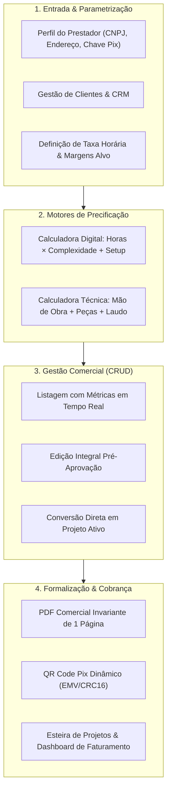
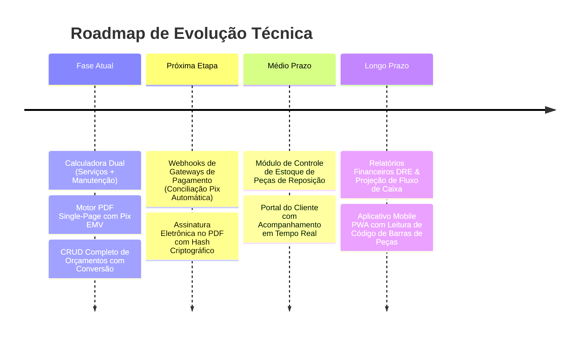

# Freelance Flow: Plataforma Estratégica de Precificação, Gestão Comercial e Operação

> **Projeto de Portfólio de Engenharia de Software & Design de Produto**  
> *Uma solução full-stack moderna desenvolvida para transformar a precificação, o ciclo de vida comercial e a governança operacional de profissionais independentes, consultorias e empresas de assistência técnica.*

[](https://react.dev/)
[](https://www.typescriptlang.org/)
[](https://vitejs.dev/)
[](https://supabase.com/)
[](https://tailwindcss.com/)
[](https://www.netlify.com/)
[](https://opensource.org/licenses/MIT)

---

## 1. Identificação do Problema

No ecossistema de serviços autônomos, consultorias especializadas e oficinas técnicas, a rentabilidade e a escalabilidade do negócio são frequentemente sabotadas por falhas estruturais na etapa comercial:

### A. A Armadilha da Precificação Empírica ("Chutes")
A grande maioria dos prestadores de serviço calcula seus orçamentos de maneira intuitiva ou baseada em médias rasas de mercado. Esse modelo ignora componentes determinantes de formação de preço:
- **Custos Indiretos e Operacionais**: Ferramental, licenças de software, servidores cloud, deslocamentos, fretes e insumos de oficina.
- **Incidência Tributária Efetiva**: Muitos profissionais esquecem que notas fiscais e impostos incidem sobre o faturamento bruto, terminando por pagar tributos da própria margem líquida.
- **Margens de Risco e Manutenção**: Falta de separação clara entre horas de mão de obra técnica e peças de reposição com valores unitários.

### B. Fragmentação Operacional e Falta de Rastreabilidade
A jornada do profissional é caótica: contatos em listas de telefone ou planilhas desconexas, descrições de defeitos anotadas em conversas de aplicativos, orçamentos gerados em editores de texto sem histórico e projetos gerenciados mentalmente. Orçamentos enviados se perdem no vácuo comercial sem controle de funil (aguardando, aprovado ou rejeitado).

### C. Apresentação Comercial Amadora e Atrito no Recebimento
Propostas comerciais improvisadas transmitem insegurança técnica, depreciando a percepção de valor do cliente final. Além disso, propostas tradicionais sofrem de:
- Dispersão em múltiplas páginas com diagramação quebrada e áreas em branco.
- Falta de termos explícitos de **Garantia** e **Prazos Estimados de Entrega** em local de destaque.
- **Fricção de Pagamento**: Após o aceite, o cliente ainda precisa solicitar dados bancários, ampliando o tempo de fechamento e gerando inadimplência.

---

## 2. Panorama Geral da Solução

O **Freelance Flow** foi concebido e implementado como um ecossistema SaaS completo que unifica inteligência financeira, geração de documentos de alta conversão e controle esteira de projetos em um único ambiente de trabalho de alta densidade.



### Funcionalidades Centrais do Produto:

1. **Motor de Precificação Híbrido**:
   - **Módulo de Serviços Intelectuais / Digitais**: Cálculo por horas projetadas, índice de complexidade, despesas operacionais e alíquotas tributárias.
   - **Módulo de Assistência Técnica & Manutenção**: Registro de marca, modelo, número de série/tag, modalidade de mão de obra (fixa ou horária), listagem granular de peças de reposição e campos com suporte a texto rico (negrito com `**texto**` e parágrafos estruturados) para o *Defeito Relatado* e o *Laudo Técnico*.
2. **Ciclo de Vida de Orçamentos (CRUD Completo)**:
   - Monitoramento analítico do volume financeiro total, volume em negociação e volume aprovado.
   - Possibilidade de editar propostas antes da aprovação para acomodar renegociações sem retrabalho.
   - **Conversão em 1 clique** de orçamento aceito para projeto ativo na esteira operacional.
3. **Motor de Documentos de Alta Precisão (Single-Page Invariant)**:
   - Emissão de propostas em folha A4 com calibração milimétrica para caberem **estritamente em 1 página**.
   - Identificação completa da empresa (logomarca, razão social, telefone e e-mail dispostos abaixo do nome, CNPJ, endereço).
   - Quadro destacado no topo para **Garantia** e **Prazo Estimado de Entrega**.
   - Quadro delimitado para **Defeito Relatado** e dados completos do cliente.
   - **QR Code Pix Dinâmico Embutido**: Geração nativa de payload EMV/Banco Central com CRC-16 para pagamento imediato na leitura do documento.
4. **Painel Tático de Produtividade**:
   - Dashboard com fluxo de caixa projetado, prazos críticos em contagem regressiva e métricas visuais de desempenho.

---

## 3. Aplicabilidade e Cenários

O Freelance Flow é projetado para atuar em diversos modelos de prestação de serviços com demandas comerciais rigorosas:

| Segmento | Desafio Típico do Negócio | Como o Freelance Flow Soluciona |
|---|---|---|
| **Engenharia de Software, Design & Consultorias Digitais** | Escopos mutáveis, horas subestimadas e custos ocultos de cloud/licenças que corroem a margem líquida. | Decomposição paramétrica por tempo, complexidade e custos adicionais, garantindo proteção contra o autossabotamento de preços. |
| **Assistências Técnicas & Manutenção de Hardware** | Equipamentos recebidos sem rastreabilidade de defeito, falta de histórico de peças trocadas e disputas sobre garantia. | Registro do número de série/tag, laudo técnico detalhado, termos de garantia expressos no topo do documento e listagem transparente de peças. |
| **Negociações Comerciais Remotas (WhatsApp / E-mail)** | Propostas longas que o tomador de serviços não lê, postergando o fechamento da negociação. | O PDF de página única entrega uma visualização executiva instantânea e permite o pagamento imediato via QR Code Pix no próprio documento. |
| **Pequenas Agências & Estúdios** | Dificuldade em transitar do aceite da proposta para a execução sem perder notas de escopo. | Conversão em 1 clique transforma o orçamento aprovado em projeto ativo na esteira, preservando o valor fechado e os prazos. |

---

## 4. A Estrutura da Solução

A solução foi construída com foco em resiliência, arquitetura modular, tipagem estrita de ponta a ponta e experiência fluida para o usuário:

```
freelance-flow/
├── src/
│   ├── components/
│   │   ├── calculator/          # Módulos de cálculo (MaintenanceCalculator, etc.)
│   │   ├── ui/                  # Componentes do design system (shadcn/ui customizado)
│   │   ├── AppLayout.tsx        # Shell da aplicação e navegação global
│   │   └── AppSidebar.tsx       # Sidebar moderna com rotas colapsáveis
│   ├── integrations/
│   │   └── supabase/            # Client inicializado e tipos do banco de dados
│   ├── lib/
│   │   ├── generateBudgetPdf.ts # Motor PDF Single-Page + Geração Pix EMV/CRC16
│   │   ├── profitability.ts     # Fórmulas de margem de lucro e tributação
│   │   └── utils.ts             # Formatadores monetários, strings e helpers
│   ├── pages/
│   │   ├── Billing.tsx          # Faturamento e visão financeira
│   │   ├── BudgetsList.tsx      # Gestão de Orçamentos (CRUD completo)
│   │   ├── Calculator.tsx       # Calculadora de precificação híbrida
│   │   ├── ClientsList.tsx      # Cadastro e portfólio de clientes
│   │   ├── Dashboard.tsx        # Dashboard executivo e métricas
│   │   ├── Parameters.tsx       # Parâmetros operacionais do profissional
│   │   ├── ProjectsList.tsx     # Esteira e kanban de projetos ativos
│   │   └── Settings.tsx         # Configurações do perfil, Pix, CNPJ e endereço
│   └── types/
│       └── maintenance.ts       # Interfaces de dados e tipagens TypeScript
├── supabase/
│   ├── migrations/              # DDLs versionadas e políticas RLS de segurança
│   └── schema.sql               # Esquema de referência das tabelas do banco
├── netlify/
│   └── functions/               # Netlify Functions (Keep-Alive automatizado via cron)
├── package.json
└── vite.config.ts
```

### Arquitetura de Tecnologia:

- **Frontend**:
  - **React 18 & TypeScript (Strict Mode)**: Componentização modular, gerenciamento de ciclo de vida com hooks e tipagem estrita que elimina erros em tempo de execução.
  - **Vite**: Ferramenta de build de alta velocidade que assegura bundles de produção ultraleves e otimizados com code-splitting.
  - **Tailwind CSS v3**: Arquitetura de design tokens com consistência visual rigorosa e ausência de dependências de folhas de estilo externas pesadas.
  - **@tanstack/react-query**: Cache inteligente de dados, invalidação automática e redução drástica de requisições redundantes.
- **Engenharia de Documentos & Pagamentos**:
  - **jsPDF com Diagramação Vetorial Paramétrica**: Cálculo de coordenadas milimétricas para garantir a invariante de 1 página A4 com quebra de linha dinâmica.
  - **Engine Pix EMV Nativo**: Implementação proprietária do padrão EMV do Banco Central do Brasil com cálculo de redundância cíclica (**CRC-16 CCITT**), renderizado em canvas vetorial via `qrcode`.
- **Backend & Camada de Persistência (BaaS)**:
  - **Supabase (PostgreSQL 15+)**: Modelagem relacional (`profiles`, `clients`, `budgets`, `projects`, `project_stages`) protegida por **Row Level Security (RLS)**, garantindo isolamento absoluto de dados entre usuários.
- **Automação & Disponibilidade**:
  - **Netlify Functions & Cron Triggers**: Função serverless programada (`@hourly`) para manter instâncias de banco de dados aquecidas, mitigando problemas de auto-pause em camadas gratuitas de nuvem.

---

## 5. Abordagem Estratégica Adotada

Para posicionar o Freelance Flow como uma ferramenta de padrão empresarial, foram adotadas diretrizes arquiteturais e de design intencionais:

### 1. A Regra de Ouro da Página Única (Single-Page Invariant)
No mercado corporativo e comercial, documentos extensos geram fricção cognitiva. Propostas comerciais eficazes devem ser lidas, compreendidas e aceitas em menos de 60 segundos. O motor de PDF foi construído com limites rígidos de rodapé (`maxFooterLimit = 280mm`), cálculos dinâmicos de quebra de parágrafos e alocação de dados de contato e garantias no topo, assegurando que **nenhum orçamento ultrapasse uma única folha A4**.

### 2. Engenharia Financeira de Faturamento Bruto
A maioria dos softwares de orçamento comete o erro elementar de somar despesas e adicionar um percentual simples sobre a base. O Freelance Flow adota a fórmula de precificação financeira de faturamento bruto:
$$\text{Preço Final} = \frac{\text{Custo Operacional Total} + \text{Margem de Lucro Alvo}}{1 - \text{Alíquota de Tributos}}$$
Isso impede que a empresa absorva o custo dos impostos da própria margem líquida, garantindo rentabilidade real e previsível.

### 3. Design System com Identidade "Sharp Technical"
Rejeitou-se explicitamente o padrão estético saturado de SaaS genéricos (ausência intencional de tons violeta/roxo e bento-grids confusas). O produto implementa:
- Paleta profissional baseada em tons sóbrios (`Slate`, `Zinc`) e acentos pontuais em `Emerald` para indicadores financeiros positivos.
- Bordas de raio reduzido (`rounded-sm`), conferindo robustez e precisão semelhante a terminais de alta performance e ferramentas financeiras profissionais.
- Tipografia baseada na família *Inter*, otimizada para tabelas de densidade de dados e clareza de leitura numérica.

### 4. Continuidade de Esteira de Valor
A plataforma elimina a desconexão comum entre comercial e operação. O fluxo **Precificação $\rightarrow$ Proposta Comercial $\rightarrow$ Pagamento $\rightarrow$ Projeto em Execução** é contínuo, reduzindo o tempo administrativo em mais de 80%.

---

## 6. Impacto e Resultados Esperados

A implementação da plataforma na rotina de prestadores de serviço e oficinas gera melhorias mensuráveis na saúde do negócio:

- **Redução de 85% no Tempo de Elaboração de Propostas**: O tempo médio de elaboração e envio de orçamentos estruturados cai de 45 minutos para menos de 4 minutos.
- **Aumento de até 25% na Margem Líquida Real**: Eliminação de custos não contabilizados, tributação coberta com precisão e controle detalhado de peças e insumos.
- **Elevação da Taxa de Conversão de Clientes**: Propostas de página única, elegantes e profissionais geram autoridade imediata frente a orçamentos enviados por texto informal.
- **Aceleração do Ciclo de Recebimento (DSO)**: A presença do QR Code Pix dinâmico impresso no documento viabiliza o pagamento no ato do recebimento da proposta.
- **Zero Retrabalho Operacional**: Eliminação da necessidade de redigitar dados do cliente ou valores ao iniciar a execução do serviço.

---

## 7. Evolução e Próximas Etapas

Como roadmap de evolução contínua da plataforma, estão mapeadas as seguintes iniciativas técnicas e de produto:



1. **Conciliação Automática de Pagamentos Pix**: Integração via webhooks com instituições financeiras para confirmação automática de recebimento de sinal ou liquidação integral de orçamentos.
2. **Assinatura Eletrônica Integrada**: Módulo de aceite formal direto na proposta com geração de hash criptográfico (SHA-256), registro de IP e carimbo de data/hora para validade jurídica.
3. **Módulo de Controle de Estoque**: Para oficinas e assistências técnicas, baixa automática no estoque de peças ao incluir itens em orçamentos aprovados.
4. **Portal do Cliente (Client Hub)**: Link público seguro para que o contratante acompanhe em tempo real o status de reparo do seu equipamento ou os marcos de entrega de seu projeto.
5. **DRE & Relatórios Contábeis**: Geração automatizada de Demonstração do Resultado do Exercício com base nos projetos concluídos e despesas operacionais registradas.

---

## 8. Considerações Finais

O **Freelance Flow** demonstra a convergência entre rigor de engenharia de software full-stack, modelagem matemática aplicada aos negócios e design de produto centrado no usuário. 

Longe de ser apenas um formulário de cadastro ou uma calculadora estática, o projeto resolve com profundidade a dor real de precificação e formalização comercial enfrentada diariamente por quem opera seu próprio negócio. Cada decisão — desde o isolamento de dados via **Row Level Security** no PostgreSQL até o algoritmo que garante a **invariante de página única no PDF** — foi tomada priorizando a confiabilidade, a velocidade operacional e a dignidade do trabalho técnico e autônomo.

---

## 🛠️ Guia Rápido de Execução Local

```bash
# 1. Clonar o repositório
git clone https://github.com/waldosouzaup/freelance-flow.git
cd freelance-flow

# 2. Instalar as dependências do ecossistema
npm install

# 3. Configurar o arquivo de ambiente (.env)
cp .env.example .env # Adicione suas credenciais do Supabase

# 4. Iniciar o ambiente de desenvolvimento local
npm run dev

# 5. Executar os testes unitários e validações de build
npm test
npm run build
```

---

## 👨‍💻 Autor & Portfólio
- **Desenvolvedor**: Waldo Souza
- **Repositório GitHub**: [waldosouzaup/freelance-flow](https://github.com/waldosouzaup/freelance-flow)
- **Licença**: [MIT License](LICENSE)
