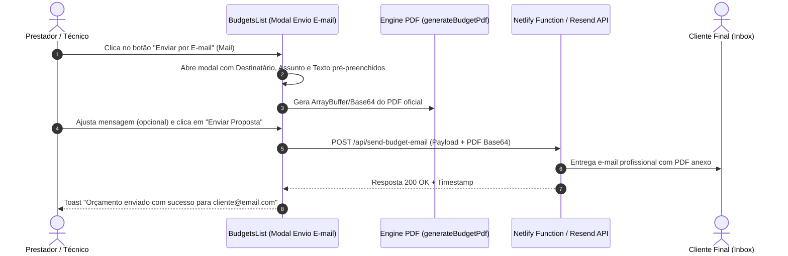

# Planejamento Técnico: Envio de Orçamento por E-mail com PDF Anexo

> **Status:** Em Análise / Planejamento Estratégico  
> **Módulo:** Ciclo Comercial de Orçamentos (`BudgetsList.tsx`)  
> **Autor / Agente:** `project-planner`  
> **Data:** 19 de Outubro de 2026

---

## 1. Visão Geral da Funcionalidade

Adicionar uma **5ª ação** na tabela de orçamentos em [BudgetsList.tsx](file:///home/waldo/Projetos/freela/freelance-flow/src/pages/BudgetsList.tsx), representada pelo ícone de envelope (`Mail`), permitindo ao prestador de serviços encaminhar a proposta comercial diretamente para o e-mail do cliente final, com:
- Nome da empresa / prestador customizado no remetente e cabeçalho.
- Assunto formatado com identificação do orçamento e projeto.
- Corpo da mensagem profissional e editável com resumo da proposta.
- Arquivo PDF oficial (de 1 página invariante) anexado diretamente ou link seguro.

---

## 2. Ações Atuais vs. Nova Ação Proposta

| Ação Atual | Ícone | Função |
|---|---|---|
| 1. Converter em Projeto | `Rocket` (verde) | Converte orçamento aceito em projeto na esteira |
| 2. Editar Orçamento | `Pencil` | Abre a proposta na Calculadora para renegociação |
| 3. Portal do Cliente | `Globe` (verde) | Link público seguro para acompanhamento em tempo real |
| 4. Baixar PDF | `FileDown` | Gera e faz o download local do PDF A4 de 1 página |
| 5. Excluir | `Trash2` (vermelho) | Remove o orçamento com diálogo de confirmação |
| **NOVA: 6. Enviar por E-mail** | **`Mail` (azul/cyan)** | **Abre diálogo de envio personalizado com PDF anexo** |

---

## 3. Arquitetura Técnica Proposta

---

## 4. Estrutura do Modal de Envio (`SendBudgetEmailModal.tsx`)

- **Campos Editáveis:**
  - **Para (Destinatário):** Preenchido automaticamente com `client_email` do cliente cadastrado.
  - **Nome do Remetente:** Puxado do perfil (`company_name` ou `display_name`).
  - **Assunto:** Sugerido: `[Nome da Empresa] Proposta Comercial - Orçamento #{budget_number} ({project_name})`.
  - **Corpo da Mensagem:** Template cordial com saudação, valor total, condições e aviso do PDF em anexo.
  - **Card de Anexo:** Identificação visual do arquivo `Orcamento_{budget_number}.pdf` com tamanho aproximado.
  - **Botão de Envio:** Disparo com feedback de loading (`Enviando e-mail...`).

---

## 5. Tarefas Previstas

- [ ] **Fase 1: Modal e UX de Envio**
  - [ ] Criar componente `SendBudgetEmailModal.tsx` com campos de destinatário, assunto, corpo e prévia do PDF
  - [ ] Adicionar botão com ícone `Mail` na coluna de ações de `BudgetsList.tsx`
- [ ] **Fase 2: Motor de Envio e Integração**
  - [ ] Configurar endpoint serverless (`netlify/functions/send-email.ts`) com provedor transacional (ex: Resend) ou fallback inteligente
  - [ ] Geração do PDF em formato binário/base64 sem disparar download no navegador
- [ ] **Fase 3: Rastreabilidade (Opcional)**
  - [ ] Registro de carimbo `email_sent_at` na tabela `budgets` para exibir tag "Enviado em DD/MM"
