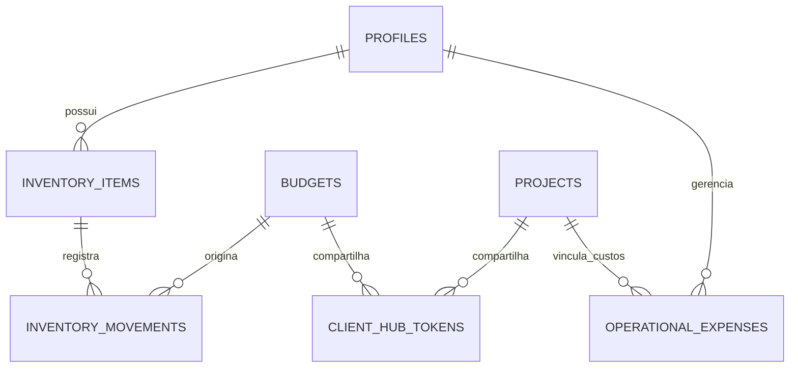
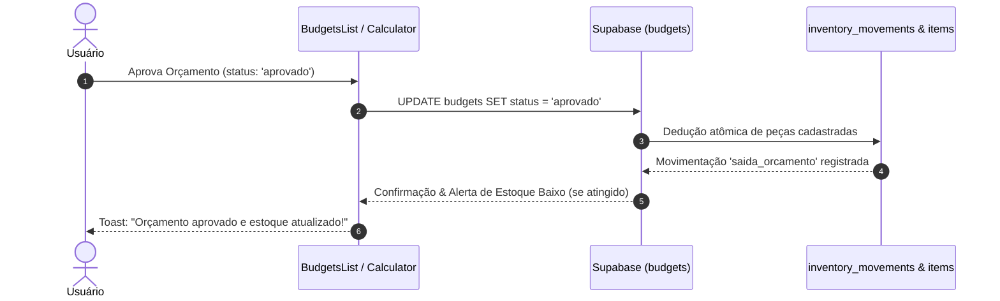

# Planejamento Técnico: Expansão Estratégica do Freelance Flow

> **Status:** Proposta Arquitetural & Plano Executivo  
> **Módulos:** Controle de Estoque com Baixa Automática, Portal do Cliente (Client Hub) e DRE & Relatórios Contábeis  
> **Data:** 19 de Outubro de 2026  
> **Autor / Agente:** `project-planner` + `orchestrator`

---

## 1. Visão Geral & Objetivos de Negócio

O ecossistema **Freelance Flow** evolui de um gerador de orçamentos e esteira de projetos para um sistema de governança operacional completo para autônomos, consultorias e oficinas de assistência técnica. Este plano detalha a arquitetura, modelo de dados, políticas de segurança e plano de tarefas para três pilares fundamentais:

1. **Módulo de Controle de Estoque (Inventory Control):**
   - Catálogo de peças e insumos com custos de aquisição, preço de venda e alertas de estoque mínimo.
   - Baixa automática no saldo físico ao aprovar orçamentos (`status = 'aprovado'`) contendo peças cadastradas.
   - Histórico de movimentações (Kardex: entradas, saídas automáticas e ajustes manuais).
   - Integração direta com a Calculadora de Manutenção (`MaintenanceCalculator`).

2. **Portal do Cliente (Client Hub / Public Tracking):**
   - Rota pública segura (`/hub/:token`) acessível pelo cliente sem necessidade de login por senha.
   - Acompanhamento em tempo real do status de reparo de hardware (equipamento, laudo, peças trocadas, garantia) ou dos marcos/etapas de projetos intelectuais.
   - Visualização e download de propostas/PDFs e QR Code Pix dinâmico integrado para pagamento direto.
   - Proteção de privacidade estrita via Supabase RPC (mascaramento de margens, taxas horárias e custos internos).

3. **DRE (Demonstração do Resultado do Exercício) & Relatórios Contábeis:**
   - Registro e categorização de Despesas Operacionais (OPEX: aluguel, internet, cloud/softwares, ferramentas).
   - Motor de apuração de DRE padronizado (Receita Bruta $\rightarrow$ (-) Impostos $\rightarrow$ Receita Líquida $\rightarrow$ (-) CPV/CSP de Peças e Custos Diretos $\rightarrow$ Lucro Bruto $\rightarrow$ (-) Despesas Operacionais $\rightarrow$ Lucro Líquido e Margem Líquida Real).
   - Filtros por competência/período (Mensal, Trimestral, Anual) e exportação em formato contábil/PDF.

---

## 2. Arquitetura de Dados & Supabase DDL



### 2.1. Tabelas Propostas

#### Tabela `inventory_items` (Peças & Insumos)
```sql
CREATE TABLE IF NOT EXISTS public.inventory_items (
  id UUID NOT NULL DEFAULT gen_random_uuid() PRIMARY KEY,
  user_id UUID NOT NULL REFERENCES auth.users(id) ON DELETE CASCADE,
  sku TEXT,
  name TEXT NOT NULL,
  description TEXT,
  category TEXT DEFAULT 'pecas',
  unit TEXT NOT NULL DEFAULT 'UN',
  quantity NUMERIC(10, 2) NOT NULL DEFAULT 0,
  min_quantity NUMERIC(10, 2) NOT NULL DEFAULT 0,
  cost_price NUMERIC(12, 2) NOT NULL DEFAULT 0,
  sale_price NUMERIC(12, 2) NOT NULL DEFAULT 0,
  location TEXT,
  created_at TIMESTAMPTZ NOT NULL DEFAULT now(),
  updated_at TIMESTAMPTZ NOT NULL DEFAULT now()
);

ALTER TABLE public.inventory_items ENABLE ROW LEVEL SECURITY;
CREATE POLICY "Users can manage own inventory" ON public.inventory_items
  FOR ALL USING (auth.uid() = user_id) WITH CHECK (auth.uid() = user_id);
```

#### Tabela `inventory_movements` (Histórico de Movimentações)
```sql
CREATE TYPE public.inventory_movement_type AS ENUM ('entrada', 'saida_orcamento', 'ajuste_manual', 'devolucao');

CREATE TABLE IF NOT EXISTS public.inventory_movements (
  id UUID NOT NULL DEFAULT gen_random_uuid() PRIMARY KEY,
  user_id UUID NOT NULL REFERENCES auth.users(id) ON DELETE CASCADE,
  item_id UUID NOT NULL REFERENCES public.inventory_items(id) ON DELETE CASCADE,
  movement_type public.inventory_movement_type NOT NULL,
  quantity NUMERIC(10, 2) NOT NULL,
  unit_cost NUMERIC(12, 2) NOT NULL DEFAULT 0,
  reference_budget_id UUID REFERENCES public.budgets(id) ON DELETE SET NULL,
  reference_project_id UUID REFERENCES public.projects(id) ON DELETE SET NULL,
  notes TEXT,
  created_at TIMESTAMPTZ NOT NULL DEFAULT now()
);

ALTER TABLE public.inventory_movements ENABLE ROW LEVEL SECURITY;
CREATE POLICY "Users can manage own inventory movements" ON public.inventory_movements
  FOR ALL USING (auth.uid() = user_id) WITH CHECK (auth.uid() = user_id);
```

#### Tabela `client_hub_tokens` (Acesso Seguro ao Portal do Cliente)
```sql
CREATE TABLE IF NOT EXISTS public.client_hub_tokens (
  id UUID NOT NULL DEFAULT gen_random_uuid() PRIMARY KEY,
  user_id UUID NOT NULL REFERENCES auth.users(id) ON DELETE CASCADE,
  token TEXT NOT NULL UNIQUE DEFAULT encode(gen_random_bytes(24), 'hex'),
  project_id UUID REFERENCES public.projects(id) ON DELETE CASCADE,
  budget_id UUID REFERENCES public.budgets(id) ON DELETE CASCADE,
  is_active BOOLEAN NOT NULL DEFAULT true,
  allow_client_approval BOOLEAN NOT NULL DEFAULT false,
  expires_at TIMESTAMPTZ,
  last_accessed_at TIMESTAMPTZ,
  created_at TIMESTAMPTZ NOT NULL DEFAULT now(),
  updated_at TIMESTAMPTZ NOT NULL DEFAULT now()
);

ALTER TABLE public.client_hub_tokens ENABLE ROW LEVEL SECURITY;
CREATE POLICY "Users can manage own hub tokens" ON public.client_hub_tokens
  FOR ALL USING (auth.uid() = user_id) WITH CHECK (auth.uid() = user_id);
```

#### RPC de Leitura Segura para Clientes Anônimos (`get_client_hub_data`)
```sql
CREATE OR REPLACE FUNCTION public.get_client_hub_data(p_token TEXT)
RETURNS JSONB
LANGUAGE plpgsql
SECURITY DEFINER
SET search_path = public
AS $$
DECLARE
  v_token_record RECORD;
  v_result JSONB;
BEGIN
  SELECT * INTO v_token_record
  FROM public.client_hub_tokens
  WHERE token = p_token AND is_active = true
    AND (expires_at IS NULL OR expires_at > now());

  IF NOT FOUND THEN
    RETURN jsonb_build_object('error', 'Token inválido ou expirado');
  END IF;

  UPDATE public.client_hub_tokens
  SET last_accessed_at = now()
  WHERE id = v_token_record.id;

  -- Monta JSON higienizado (sem dados de custo interno, taxa horária do profissional ou notas confidenciais)
  SELECT jsonb_build_object(
    'token', v_token_record.token,
    'provider', (
      SELECT jsonb_build_object(
        'company_name', p.company_name,
        'display_name', p.display_name,
        'phone', p.phone,
        'email', u.email,
        'avatar_url', p.avatar_url,
        'pix_key', p.pix_key,
        'pix_key_type', p.pix_key_type
      )
      FROM public.profiles p
      JOIN auth.users u ON u.id = p.user_id
      WHERE p.user_id = v_token_record.user_id
    ),
    'project', (
      SELECT jsonb_build_object(
        'id', pr.id,
        'name', pr.name,
        'description', pr.description,
        'status', pr.status,
        'deadline', pr.deadline,
        'value', pr.value,
        'stages', (
          SELECT COALESCE(jsonb_agg(
            jsonb_build_object(
              'id', st.id,
              'title', st.title,
              'completed', st.completed,
              'sort_order', st.sort_order
            ) ORDER BY st.sort_order ASC
          ), '[]'::jsonb)
          FROM public.project_stages st
          WHERE st.project_id = pr.id
        )
      )
      FROM public.projects pr
      WHERE pr.id = v_token_record.project_id
    ),
    'budget', (
      SELECT jsonb_build_object(
        'id', bg.id,
        'budget_number', bg.budget_number,
        'status', bg.status,
        'project_name', bg.project_name,
        'total_value', bg.total_value,
        'created_at', bg.created_at,
        'public_data', jsonb_build_object(
          'productName', bg.budget_data->>'productName',
          'brandModel', bg.budget_data->>'brandModel',
          'serialNumber', bg.budget_data->>'serialNumber',
          'reportedIssue', bg.budget_data->>'reportedIssue',
          'technicalDiagnosis', bg.budget_data->>'technicalDiagnosis',
          'warrantyDays', bg.budget_data->>'warrantyDays',
          'estimatedDaysToDeliver', bg.budget_data->>'estimatedDaysToDeliver',
          'paymentConditions', bg.budget_data->>'paymentConditions'
        )
      )
      FROM public.budgets bg
      WHERE bg.id = v_token_record.budget_id
    )
  ) INTO v_result;

  RETURN v_result;
END;
$$;
```

#### Tabela `operational_expenses` (Despesas Operacionais & OPEX)
```sql
CREATE TYPE public.expense_category AS ENUM (
  'administrativa',
  'software_cloud',
  'ferramentas_oficina',
  'infraestrutura',
  'comercial_marketing',
  'tributos_taxas',
  'outros'
);

CREATE TABLE IF NOT EXISTS public.operational_expenses (
  id UUID NOT NULL DEFAULT gen_random_uuid() PRIMARY KEY,
  user_id UUID NOT NULL REFERENCES auth.users(id) ON DELETE CASCADE,
  description TEXT NOT NULL,
  category public.expense_category NOT NULL DEFAULT 'administrativa',
  amount NUMERIC(12, 2) NOT NULL,
  expense_date DATE NOT NULL DEFAULT CURRENT_DATE,
  is_recurring BOOLEAN NOT NULL DEFAULT false,
  recurring_period TEXT DEFAULT 'mensal', -- mensal, anual
  project_id UUID REFERENCES public.projects(id) ON DELETE SET NULL,
  notes TEXT,
  created_at TIMESTAMPTZ NOT NULL DEFAULT now(),
  updated_at TIMESTAMPTZ NOT NULL DEFAULT now()
);

ALTER TABLE public.operational_expenses ENABLE ROW LEVEL SECURITY;
CREATE POLICY "Users can manage own expenses" ON public.operational_expenses
  FOR ALL USING (auth.uid() = user_id) WITH CHECK (auth.uid() = user_id);
```

---

## 3. Lógica de Baixa Automática de Estoque



1. **Gatilho de Baixa:**
   - Executado quando um orçamento contendo peças (`budget_data.parts`) transita para o status `aprovado`.
   - Pode ser implementado via Postgres Function (`public.process_budget_stock_depletion(p_budget_id UUID)`) chamada no ato da aprovação para garantia de atomicidade.
2. **Identificação de Peças:**
   - Peças podem conter `inventory_item_id` se selecionadas a partir do catálogo do estoque, ou match por `sku` / nome.
3. **Tratamento de Exceções & Reversão:**
   - Se um orçamento aprovado for cancelado (`status = 'cancelado'`), o sistema estorna automaticamente as movimentações gerando registros de `devolucao`.
   - Se a quantidade em estoque for menor que o necessário, o sistema avisa o usuário e oferece opção de prosseguir (saldo negativo com sinalização visual) ou bloquear a aprovação.

---

## 4. Estrutura do DRE & Motor de Demonstração de Resultado

```
(+) 1. RECEITA OPERACIONAL BRUTA
    ├── Receita de Projetos Concluídos no Período
    └── Receita de Orçamentos Aprovados e Faturados

(-) 2. DEDUÇÕES DA RECEITA BRUTA
    └── Alíquota Efetiva de Impostos (Simples Nacional / ISS configurado em Parâmetros)

(=) 3. RECEITA OPERACIONAL LÍQUIDA (1 - 2)

(-) 4. CUSTOS DOS SERVIÇOS & PEÇAS PRESTADOS (CPV / CSP)
    ├── Custo de Aquisição das Peças Utilizadas (CMV do Estoque)
    └── Custos Diretos Registrados em Projetos (actual_costs)

(=) 5. LUCRO BRUTO (3 - 4)
    └── Margem Bruta (%)

(-) 6. DESPESAS OPERACIONAIS (OPEX)
    ├── Despesas com Ferramental e Equipamentos
    ├── Assinaturas de Software & Infraestrutura Cloud
    ├── Despesas Administrativas Gerais (aluguel, energia, internet)
    └── Despesas Comerciais e Marketing

(=) 7. RESULTADO OPERACIONAL LÍQUIDO / EBIT (5 - 6)

(=) 8. LUCRO LÍQUIDO DO PERÍODO
    └── Margem Líquida Real (%)
```

---

## 5. Estrutura de Rotas e Telas

| Rota | Tipo | Descrição |
|---|---|---|
| `/inventory` | `ProtectedRoute` | Listagem de itens, saldo em estoque, alertas de reposição, registro de entradas e saídas. |
| `/billing` | `ProtectedRoute` | Expandido para incluir aba de **DRE & Relatórios Contábeis** com filtros por período e exportação PDF. |
| `/expenses` | `ProtectedRoute` | Gestão e categorização de despesas operacionais (fixas, recorrentes e avulsas). |
| `/hub/:token` | `PublicRoute` | **Portal do Cliente:** Link público de alta fidelidade visual, com stepper de status, detalhes do serviço e Pix dinâmico. |

---

## 6. Plano de Tarefas & Sequência de Execução

- [x] **Fase 1: Infraestrutura de Banco de Dados & Migrations**
  - [x] Criar tabelas `inventory_items`, `inventory_movements`, `client_hub_tokens` e `operational_expenses` em `supabase/migrations/`
  - [x] Implementar RPC `get_client_hub_data(token)` e schemas DDL no `supabase/schema.sql`
  - [x] Atualizar tipos TypeScript em `src/integrations/supabase/types.ts`
- [x] **Fase 2: Módulo de Controle de Estoque**
  - [x] Desenvolver página `src/pages/Inventory.tsx` com tabela rica, busca, filtros e indicadores de estoque baixo
  - [x] Criar modal de criação/edição de item (`ItemFormDialog.tsx`) e modal de ajuste/entrada manual (`MovementDialog.tsx`)
  - [x] Implementar histórico de movimentações Kardex (`MovementsHistoryDialog.tsx`)
  - [x] Integrar busca de peças do estoque com auto-preenchimento dentro do `MaintenanceCalculator.tsx`
  - [x] Conectar gatilho de baixa automática na aprovação de orçamento e estorno em cancelamento em `BudgetsList.tsx`
- [x] **Fase 3: Portal do Cliente (Client Hub)**
  - [x] Criar serviço de geração de token seguro (`clientHubService.ts`)
  - [x] Implementar modal de compartilhamento com WhatsApp e toggle ativo/inativo (`ClientHubModal.tsx`)
  - [x] Integrar ação "Portal do Cliente" no `BudgetsList.tsx` e `ProjectDetails.tsx`
  - [x] Desenvolver página pública `/hub/:token` (`ClientHub.tsx`) com stepper de status, laudo técnico, download de PDF e QR Code Pix
- [x] **Fase 4: Despesas Operacionais & DRE Automatizado**
  - [x] Criar tipos e motor matemático de DRE (`dreCalculator.ts`) com apuração por competência
  - [x] Desenvolver componente de gestão de despesas operacionais (`ExpensesTab.tsx`)
  - [x] Desenvolver demonstrativo contábil interativo (`DRETab.tsx`) com visão analítica e impressão
  - [x] Integrar tabs em `Billing.tsx` e registrar rota de navegação no `AppSidebar.tsx`
- [x] **Fase 5: Testes, Verificações e Documentação**
  - [x] Testes unitários do motor de DRE e serviço de estoque (`npm test`)
  - [x] Verificação de build de produção (`npm run build`) com 100% de sucesso
